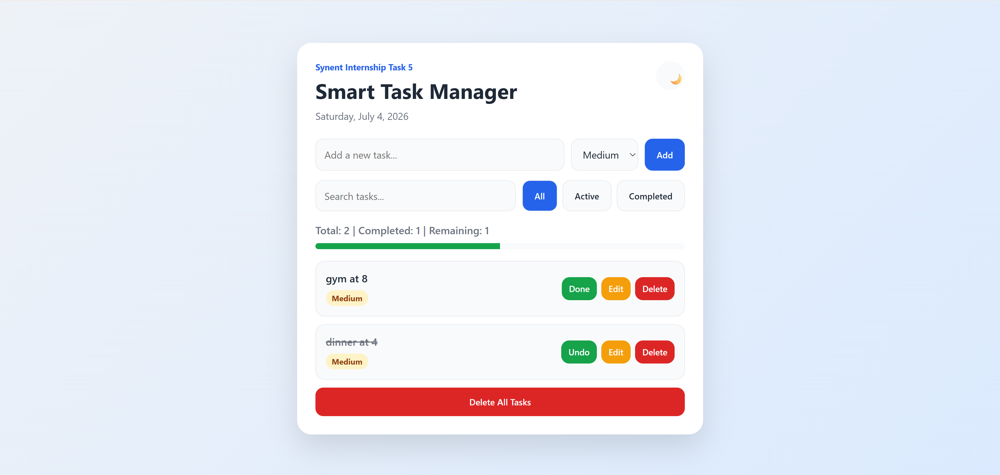

# Smart Task Manager

[](https://jad-obeidd.github.io/synent-task5-todoapp-jadobeid/)

A responsive task-management web application built during my Synent Technologies Web Development Internship. It helps users organize daily tasks and stores their data locally in the browser.



## Features

- Add, edit, complete, and delete tasks
- Search tasks instantly
- Filter by all, active, or completed
- Assign low, medium, or high priority
- Track completion with progress and statistics
- Delete all tasks
- Dark and light themes
- Persistent data using Local Storage
- Responsive mobile and desktop interface

## Built With

- HTML5
- CSS3
- Vanilla JavaScript
- Web Storage API

## Run Locally

```bash
git clone https://github.com/jad-obeidd/synent-task5-todoapp-jadobeid.git
cd synent-task5-todoapp-jadobeid
```

Open `index.html` in your browser. No installation or build step is required.

## Project Structure

```text
.
├── index.html
├── style.css
└── script.js
```

## Live Demo

[jad-obeidd.github.io/synent-task5-todoapp-jadobeid](https://jad-obeidd.github.io/synent-task5-todoapp-jadobeid/)

## Possible Improvements

- Due dates and reminders
- Task categories
- Drag-and-drop ordering
- Cloud synchronization

## Author

**Jad Obeid**  
[GitHub](https://github.com/jad-obeidd) · [LinkedIn](https://www.linkedin.com/in/jad-obeid-748a642a0/)

## Note

Created for educational and internship purposes.
